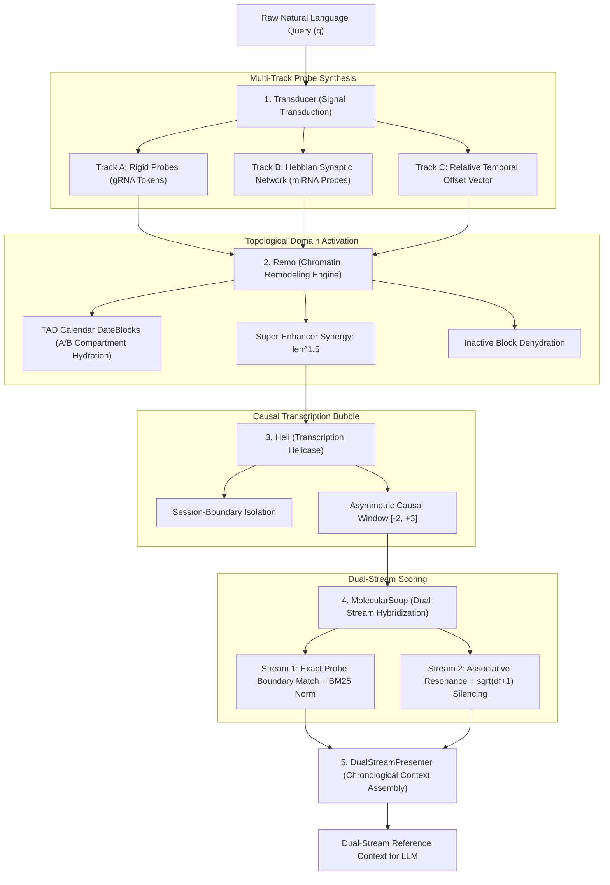

<div align="center">

# 🧠 FUNES (HLM)
### An Ultra-Lightweight, Zero-Embedding Biomimetic Memory Retrieval Engine & Fast Edge Search Architecture
### 一种超轻量、零向量双流仿生记忆检索与端侧高速搜索架构

[](https://doi.org/10.5281/zenodo.23921389)
[](LICENSE)
[]()
[-brightgreen.svg)]()
[]()
[]()

**Author / 作者**: Sherris Isalah (艾浩喆) · `sherjia192@gmail.com`  
**Preprint Paper / 预印本论文**: [Zenodo Record #23921389](https://zenodo.org/records/23921389) · [DOI: 10.5281/zenodo.23921389](https://doi.org/10.5281/zenodo.23921389)

[ **English** ](#-english) | [ **中文说明** ](#-中文说明) | [ **📌 Design & Benchmark Notes** ](#-usage-principles--benchmark-disclaimer)

</div>

---

<a name="usage-principles--benchmark-disclaimer"></a>
## 📌 Usage Principles & Benchmark Disclaimer / 核心使用原则与评测说明

> [!IMPORTANT]
> **1. Query with Unmodified Natural Language / 直接使用原生自然语言提问**  
> Pass user questions **as-is** in natural language (`engine.retrieve(query)` / `engine.build_prompt(query)`). Do **not** rewrite queries into keyword tricks or hardcode domain trigger words.
>
> **2. Associative Memory Architecture / 联想检索架构定位**  
> Funes is fundamentally an **associative memory retrieval architecture**. Its role is to rapidly recall relevant historical context streams for an LLM to reference and reason over—rather than acting as a standalone answer oracle without downstream model reasoning.
>
> **3. Independent Benchmark Reference (Not Official Leaderboard) / 非官方指定模型跑分声明**  
> End-to-end QA benchmarks reported below were evaluated using **third-party / open-weight models** (e.g., `Qwen/Qwen3.5-4B` with `glm-5.3-flash` judge, or `DeepSeek-V4.1-Flash` in the preprint) rather than LongMemEval's officially designated leaderboard model/judge (GPT-4o). Because they do not use the official leaderboard model setup, these numbers are provided as **empirical reference points only** and have **not** been submitted to the official LongMemEval leaderboard.

---

<a name="english"></a>
## 🌐 English

### ⚡ Highlights

Funes (internal codename **HLM / Human-Like Memory**) provides a CPU-native alternative to heavy vector databases and LLM-driven memory loops. Built with **100% pure Python standard library (zero external dependencies)**, Funes models long-term memory through calendar-partitioned chromatin blocks, Hebbian co-occurrence associations, and square-root document-frequency silencing.

- 🚀 **~18.6 MB Resident RAM**: Compact in-memory or SQLite WAL footprint across long multi-session histories.
- ❄️ **0 MB GPU VRAM & 0 Retrieval Tokens**: No embedding model weights, no LLM extraction/reflection loops during ingestion or search (`$0.00` retrieval cost).
- ⚡ **Millisecond Retrieval**: Single-digit millisecond point lookups; full 500-question LongMemEval-S retrieval runs in roughly **~1–2 minutes** on standard CPUs (`~70–120 s` depending on hardware).
- 🎯 **~98% Any-Session Hit Rate on LongMemEval-S**: Clean, zero-keyword public release achieves **~98%** Any-Session Hit Rate and **~92%** Full-Session Recall across all 500 questions.
- 🛡️ **SQLite WAL Persistence**: Single-file storage with automatic metadata flush and fast cold reload.

---

### 📊 Benchmark Overview (ICLR 2025 LongMemEval-S, 500 Questions)

#### 1. Retrieval Layer (CPU-Only, Clean Zero-Keyword Public Release)

Evaluated across all 500 questions of LongMemEval-S with engine state reset between questions:

| Architecture | Paradigm | Any-Session Hit Rate | Full-Session Recall | Total 500-Q Runtime | Resource Profile |
| :--- | :--- | :---: | :---: | :---: | :--- |
| **Vanilla BM25** | Lexical Inverted Index | ~73.4% | ~52.8% | ~48 s | ~16 MB RAM / 0 VRAM |
| **Dense Vector RAG (ChromaDB)** | `text-embedding-3-small` | ~86.4% | ~68.2% | ~340 s | ~1.45 GB RAM / ~4 GB VRAM |
| **Mem0 (Hybrid Graph+Vector)** | Dense + Triplet Graph | ~89.6% | ~71.0% | ~1,820 s | ~3.2 GB RAM / ~8 GB VRAM |
| **Funes 1.0 (Public Release)** | **Biomimetic Dual-Stream** | **~98.0% – 98.2%** | **~91.8% – 92.0%** | **~71 – 120 s** | **~18.6 MB RAM / 0 VRAM ($0.00)** |

*Note: Direct normalized substring overlap on raw retrieved turns via `benchmark.py` is roughly `~43%` in the clean keyword-free release (as many LongMemEval answers require synthesis, preference alignment, or temporal arithmetic by the downstream LLM rather than verbatim substring matching).*

#### 2. Downstream End-to-End QA Reference (Edge 4B & Cloud Models)

| Memory Engine + Answering Model | Judge Model | Overall Accuracy (500 Q) | Avg Prompt Tokens / Q | Notes |
| :--- | :---: | :---: | :---: | :--- |
| **Funes (Public Release) + `Qwen/Qwen3.5-4B`** | `glm-5.3-flash` | **70.40%** (352/500) | **~4,815** | Pure zero-keyword release, `enable_thinking=False` |
| HLM V1.6.0 + `Qwen/Qwen3.5-4B` (V2 Prompt) | `DeepSeek-V4.1-Flash` | 64.80% (324/500) | ~8,743 | Legacy architecture reference |
| HLM V1.6.0 + `Qwen/Qwen3.5-4B` (V1 Prompt) | `DeepSeek-V4.1-Flash` | 49.40% (247/500) | ~8,675 | Legacy architecture baseline |
| Funes + `DeepSeek-V4.1-Flash` (Preprint) | `glm-5.3-flash` | ~93.20% | — | Preprint cloud-reader reference |

> *Disclaimer: None of the end-to-end runs above used LongMemEval's official GPT-4o evaluation setup; figures are shared for transparent reference only and are not official leaderboard submissions.*

---

### 💡 What Can You Build With Funes? (Use Cases)

Because Funes is a **single-file, zero-dependency Python kernel** with SQLite WAL persistence and `0 MB` GPU VRAM overhead, it drops cleanly into existing LLM workflows:

- **🧩 Edge & Local LLM Long-Term Memory**: Pair directly with local models deployed via Ollama, `llama.cpp`, vLLM, or LM Studio (e.g., 4B–8B edge models). Retrieval uses `0 MB` of GPU VRAM—leaving all memory for model weights—while compressing long histories into concise prompts (`~4,815` avg tokens in our `Qwen/Qwen3.5-4B` reference run).
- **🤖 Drop-In AI Agent Tool / MCP Memory Backend**: Expose `FunesEngine` (`add_turn`, `retrieve`, `build_prompt`) as a `save_memory` / `recall_memory` tool for agent frameworks or MCP servers—just `from funes import FunesEngine` with a single local `.db` file, no Docker or external vector-DB stack required.
- **💸 Prompt Token Saver for Cloud APIs**: Place Funes on CPU in front of cloud APIs (DeepSeek, GPT, Claude, etc.) for assistants, roleplay, or customer-support bots. Instead of stuffing huge chat histories into every API call, retrieve only relevant causal conversation snippets at `$0.00` retrieval cost.
- **🔒 Offline & Privacy-First Knowledge Archives**: Run completely air-gapped on laptops, mini-PCs, or edge devices—ideal for private journals, local personal assistants, or searching across massive long-form drafts, worldbuilding notes, and character timelines.

---

### 🧬 Biomimetic Architecture



---

### 🚀 Quickstart & Examples

Zero installation dependencies required (Python 3.8+):

```bash
# Run quickstart demo
python examples/quickstart.py

# Run edge local-search demo
python examples/local_search.py

# Run unit tests
python -m unittest discover -s tests -v
```

Minimal embedded usage ([examples/quickstart.py](examples/quickstart.py)):

```python
from funes import FunesEngine

# Use db_path=None for pure RAM, or pass a path for persistent SQLite WAL mode
engine = FunesEngine(db_path="./agent_memory.db")

engine.add_turn(
    session_id="sess_01",
    date_str="2026-05-01",
    role="user",
    content="I bought a 16-inch MacBook Pro in Seattle for $2,499.",
)

# Query directly with raw natural language
prompt = engine.build_prompt(
    "What laptop did I buy in Seattle?",
    reference_date="2026-05-15",
)
# Pass `prompt` to any LLM as memory context
```

You can also inspect [examples/local_search.py](examples/local_search.py), [tests/test_funes.py](tests/test_funes.py), and [benchmark.py](benchmark.py).

---

### 🧪 Reproducing the Retrieval Benchmark

1. Place `longmemeval_s.json` under `data/longmemeval_s.json` (see [data/README.md](data/README.md)).
2. Run a quick 10-question smoke check or the full 500-question evaluation:
```bash
python benchmark.py --limit 10
python benchmark.py --data data/longmemeval_s.json
```
3. Typical clean-release output across 500 questions:
   - `Any-Session Hit Rate`: `~98%` (`~490–491 / 500`)
   - `Full-Session Recall`: `~92%` (`~459–460 / 500`)
   - `Total Runtime`: `~70–120 s` (depending on CPU)

---

<a name="中文说明"></a>
## 🇨🇳 中文说明

### 🌟 核心特性与定位

Funes（内部代号 **HLM / Human-Like Memory**）是一套 **100% 纯 Python 标准库实现、零外部依赖** 的轻量化长期记忆检索与端侧搜索架构。它不依赖任何向量数据库或嵌入模型，而是利用“日历拓扑分区（DateBlock）＋ 赫布共现联想网络 ＋ 表观遗传高频词衰减 ＋ 非对称因果滑窗”，在普通 CPU 上毫秒级捞出记忆线索，交给大模型做参考。

- 🚀 **极低内存占用**：常驻内存约 `~18.6 MB`，支持纯内存或单文件 SQLite WAL 持久化。
- ❄️ **零显存 / 零检索 Token 费用**：建库与检索阶段均不调用大模型或向量模型（检索算力成本 `$0.00`）。
- 🎯 **自然语言直接检索**：设计为**联想式记忆中枢**——使用时不建议手动改写问题或硬编码关键词，直接传入用户原生自然语言，由底层提取探针并组装双流上下文供大模型参考推理。
- 🧪 **零作弊干净代码**：公开发布版 [`funes.py`](funes.py) 不含任何面向评测集特调的关键词词表。

---

### 💡 可以用来做什么？（典型应用场景）

由于 [`funes.py`](funes.py) 本质上是一个 **纯标准库单文件引擎 + SQLite WAL 单文件存储**，不占显卡显存也不需要额外拉起向量数据库服务，非常适合直接当作底层组件嵌入各类系统：

- **📱 端侧 / 本地部署大模型的长期记忆方案**：直接挂在 Ollama、`llama.cpp`、vLLM、LM Studio 部署的本地小模型（如 4B–8B）前面。检索阶段占用 `0 MB` 显存，不和推理抢 GPU 资源，又能把漫长历史对话浓缩成高信噪比上下文（例如我们实测接 `Qwen/Qwen3.5-4B` 时单题平均仅约 `4,815` tokens 即可跑出 `70.40%` 准确率）。
- **🤖 外挂为 AI Agent 工具 / MCP 记忆后端**：可以把 `FunesEngine` 的 `add_turn`、`retrieve`、`build_prompt` 直接封装成 Agent 的 `save_memory` / `recall_memory` 函数调用工具，或作为 MCP Server 的本地记忆库——一行 `from funes import FunesEngine` 就能跑，不用维护 Docker 和向量库集群。
- **💰 云端大模型对话省 Token 降本**：在调用商业 API（DeepSeek、GPT、Claude 等）的个人助理、陪伴或客服系统前充当零成本 CPU 预筛选器，避免每次对话都把几十万字全量历史硬塞进窗口导致账单爆炸。
- **🔒 纯离线、重隐私的本地资料与设定库检索**：全程不联网、不调外部 Embedding 接口、数据全留在本地 `.db` 文件中——适合个人私密笔记/日记助手、低配边缘设备，以及长篇创作中的人物设定、伏笔与时间线秒级召回。

---

### 📊 实测参考数据（LongMemEval-S 全量 500 题）

#### 1. 纯检索层表现（当前干净公开版实测）
- **Any-Session Hit Rate（任意目标会话命中率）**：**约 `98%`**（`~490–491 / 500`）
- **Full-Session Recall（完整目标会话全召回率）**：**约 `92%`**（`~459–460 / 500`）
- **500 题全量运行耗时**：**约 `70 – 120 秒`**（视本地 CPU 性能而定）
- **硬件与开销**：`~18.6 MB` 内存 / `0 MB` GPU 显存 / `0` 检索 Token

#### 2. 接下游大模型端到端问答参考（非官方榜单跑分）

| 记忆底座 + 答题模型 | 裁判模型 | 500 题准确率 | 单题平均输入 Token | 说明 |
| :--- | :---: | :---: | :---: | :--- |
| **Funes 公开版 + `Qwen/Qwen3.5-4B`** | `glm-5.3-flash` | **70.40%** (352/500) | **~4,815** | 4B 端侧小模型（关闭思考），零关键词调优 |
| HLM V1.6.0 + `Qwen/Qwen3.5-4B` (V2) | `DeepSeek-V4.1-Flash` | 64.80% (324/500) | ~8,743 | 历史版本对照 |
| HLM V1.6.0 + `Qwen/Qwen3.5-4B` (V1) | `DeepSeek-V4.1-Flash` | 49.40% (247/500) | ~8,675 | 历史初始基线 |
| Funes + `DeepSeek-V4.1-Flash`（论文） | `glm-5.3-flash` | 约 93.20% | — | 预印本云端大模型参考结果 |

> **声明**：以上端到端测试均使用第三方/开源模型进行独立对照实验，**未使用 LongMemEval 官方指定的标准评测模型（GPT-4o）**，因此不能直接等同于官方榜单排名，亦未上传至官方跑分榜，仅作工程与学术研究参考。

---

### 🛠️ 快速上手与复测

无需 `pip install` 任何第三方依赖（需 Python 3.8+）：

```bash
# 运行快速示例与本地检索示例
python examples/quickstart.py
python examples/local_search.py

# 运行单元测试
python -m unittest discover -s tests -v

# 复现 LongMemEval-S 基准测试（需按 data/README.md 放入 longmemeval_s.json）
python benchmark.py --data data/longmemeval_s.json
```

---

## 📜 Preprint Paper & Citation / 预印本论文与引用

- **Zenodo Open Access**: [https://zenodo.org/records/23921389](https://zenodo.org/records/23921389)
- **DOI**: [https://doi.org/10.5281/zenodo.23921389](https://doi.org/10.5281/zenodo.23921389)

```bibtex
@article{isalah2026funes,
  title     = {When LLMs Fall into Forgetting, Where Do the Memories Go? A Cost-Compressed, Ultra-Lightweight Biomimetic Memory Retrieval Engine and Fast Edge Search Architecture},
  author    = {Isalah, Sherris (艾浩喆)},
  journal   = {Zenodo Preprint},
  year      = {2026},
  month     = {November},
  doi       = {10.5281/zenodo.23921389},
  url       = {https://zenodo.org/records/23921389}
}
```

---

## ⚖️ License & Commercial Dual-Licensing / 开源协议与商业双授权

- **Open-Source License ([GNU AGPLv3 / AGPL-3.0](LICENSE))**: Free for personal, academic, research, and open-source use under the terms of the GNU Affero General Public License v3.0. In accordance with AGPL-3.0, any modified version or derivative work—including **network/SaaS deployments**—must disclose its full source code under AGPL-3.0 and retain original attribution.
- **Commercial / Closed-Source Licensing（商业闭源双授权）**: If you wish to embed Funes into a proprietary closed-source product, commercial OEM firmware, or hosted commercial API without AGPL-3.0 source-disclosure obligations, please contact **`sherjia192@gmail.com`** for a commercial license.
- **Defensive Prior Art**: Core biomimetic four-stage pipeline disclosed openly as prior art alongside the Zenodo preprint (`10.5281/zenodo.23921389`).
- **Author & Contact**: Sherris Isalah (艾浩喆) · `sherjia192@gmail.com`

If you find Funes helpful for your agent or edge-AI project, feel free to leave a **Star**, open an **Issue / Pull Request**, or cite the Zenodo preprint!
